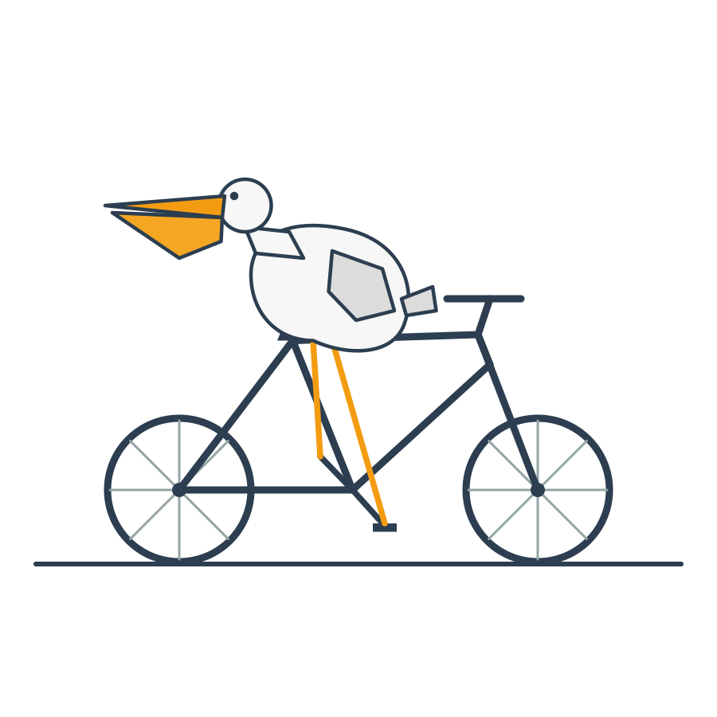

# 实测记录

本文件记录在本机 `127.0.0.1:3067` 上对 4 个模型做的实测，数据来自 2026-10-28 的一轮完整测试。
结论只代表这一轮、这一账号、这一时段的观测，上游随时可能调整。

模型清单（来自上游 `/models/search` 自动发现）：

| 模型 | provider | 上游 baseUrl |
| --- | --- | --- |
| `deepseek-v4.1-flash` | deepseek | `https://dashenghl.sais.org.cn/v1` |
| `deepseek-v4-pro-0813` | deepseek | 同上 |
| `glm-5.2` | glm | 同上 |
| `qwen3.8-max` | qwen | 同上 |

## 1. 生成速率（TPS）

口径：固定写作题，取上游 `content[].startedAt → endedAt` 的生成窗口，排除排队与轮询误差；
token 数为估算（中日韩字符 ×0.7/字，其余 4 字符 ≈ 1 token），因为上游不返回 `usage`。

| 模型 | 输出 | 生成耗时 | 估算 TPS |
| --- | --- | --- | --- |
| `deepseek-v4.1-flash` | 275 字 / ~188 tok | 2.75 s | **68** |
| `glm-5.2` | 322 字 / ~224 tok | 3.83 s | **58** |
| `glm-5.2`（复测） | 364 字 / ~252 tok | 4.54 s | 55 |

同一模型多次跑波动约 10%。管理面板的「速率测试」卡片就是这套算法。

## 2. 思考强度

上游确实有独立的 `thinking` 内容块，但**思考正文长度为 0**（只给块标记、不给内容），
所以无法从内容侧衡量，只能用时间差间接估算。

| 题目难度 | 总耗时 | 生成窗口 | thinking 块 | 正文 |
| --- | --- | --- | --- | --- |
| 简单（首都） | 3.35 s | ≈0 s | 无 | 2 字 |
| 中等（解方程） | 3.31 s | ≈0 s | 无 | 2 字 |
| 复杂（工程合作） | 4.80 s | ≈0 s | 有 | 2 字 |
| 复杂 + 长推理（MST 方案） | 31.3 s | 15.6 s | 有 | 1827 字 |

- 难度越高、思考越久，出现 `thinking` 块的概率越大。
- 长推理题里约 15.7 s 不在生成窗口内，基本就是思考 + 排队，占了总耗时一半。
- 本反代会**丢弃 thinking**，客户端看不到思考内容，只能感受到首字延迟（= 思考时长）。这是取舍，不是缺陷。

## 3. 上下文长度

方法是 needle 检索：把随机编号 `ZQ????-7K` 埋在长文本的 50% 位置，要求模型只输出该编号。

| 上下文 | 耗时 | 召回 |
| --- | --- | --- |
| 2,016 字 | 3.7 s | 成功 |
| 8,016 字 | 6.9 s | 成功 |
| 20,016 字 | 12.1 s | 成功 |
| 40,016 字 | 27.0 s | 成功 |
| 80,016 字 | 15.7 s | 成功 |
| 160,016 字 | 39.5 s | 成功 |
| 240,016 字 | 33.2 s | 成功 |
| **320,016 字** | 42.3 s | **成功** |

- 32 万汉字（约 20 万+ token）仍能准确召回，**没有触顶**，反代侧也不做任何截断。
- 耗时与长度几乎无关（160k 比 240k 还慢），瓶颈是排队/调度抖动，不是上下文长度。

## 4. 输出长度与失败模式

| 请求 | 实际输出 | 耗时 | 结果 |
| --- | --- | --- | --- |
| ≥500 字 | 1387 字 | 30.8 s | 正常 |
| ≥2000 字 | 3662 字 | 37.2 s | 正常 |
| ≥6000 字（榫卯） | 1146 字 | 172.0 s | 正常（模型不愿写长） |
| ≥8000 字（深海热泉） | 848 字 | 46.6 s | **上游安全护栏截断** |
| ≥8000 字（同题复测） | 0 字 | 301.3 s | 反代超时（旧默认 300 s） |

两种失败模式：

1. **内容安全护栏**：上游命中审核会中断生成并追加 `--检测到内容违规--安全护栏`，
   此时 `stopReason` 仍返回 `stop`，客户端只能靠这个尾巴字串判断。
2. **反代超时**：上游还在生成、反代先放弃，返回
   `502 {"error":{"message":"等待模型回复超时","type":"upstream_error"}}`。
   默认 `timeout_seconds` 已由 300 调至 900。

从未观察到 `finish_reason=length`，说明不存在硬性的输出 token 上限；写不长是模型自己的取舍。

## 5. 鹈鹕骑自行车（SVG 空间推理）

经典绘图题：要求返回纯 SVG（`viewBox="0 0 600 400"`），自行车要有两轮、辐条、车架、座垫、车把，
鹈鹕要坐在座垫上、有翅膀、长喙和喉袋。四个模型全部产出了可正常渲染的 SVG，无一语法错误，
也没有用 `<text>` 作弊。

| 模型 | 耗时 | SVG | 自行车完整度 | 鹈鹕还原度 | 综合 |
| --- | --- | --- | --- | --- | --- |
| `qwen3.8-max` | 219.7 s | 5 KB | 轮毂/辐条/曲柄/脚踏/座垫/车把齐全 | 长颈+喉袋+羽冠，腿部交叉穿模 | **1** |
| `glm-5.2` | 80.6 s | 3 KB | 车架+轮+车把完整，缺脚踏 | 喙袋饱满、有翅膀，缺腿 | **2** |
| `deepseek-v4.1-flash` | 44.8 s | 4 KB | 车架/轮/车把，有单脚踩踏板 | 喙袋形状对，但缺脖子 | **3** |
| `deepseek-v4-pro-0813` | 149.3 s | 2 KB | 结构正确但极简 | 喙退化成三角形，腿穿到车轮里 | **4** |

- `qwen3.8-max`：唯一画出「曲柄 + 脚踏 + 链轮」这级细节，也是唯一给鹈鹕画羽冠和弯曲脖颈的；腿部结构有交叉。
- `glm-5.2`：构图最完整（天空/地面/配色），静态观感最好，机械细节少一档。
- `deepseek-v4.1-flash`：最快（qwen 的 1/5），形态卡通但准确，脚压在踏板上；硬伤是头和身体连成一体、没有脖子。
- `deepseek-v4-pro-0813`：最慢却画得最省，喉袋特征丢失。

公共结论：画错不是被截断或降级，而是**空间推理能力的差别**——
把「坐在座垫上、脚够到脚踏、两轮着地」同时对齐，只有 qwen 和 glm 做到了。

渲染结果：

| qwen3.8-max | glm-5.2 |
| --- | --- |
|  |  |

| deepseek-v4.1-flash | deepseek-v4-pro-0813 |
| --- | --- |
|  |  |

## 6. 动态鹈鹕骑车（SVG 动画）

题面在静态版基础上加动画约束：必须**自包含**（不许 JS、不许外链），用 SMIL `<animateTransform>`
或 CSS `@keyframes` 实现「车轮转、曲柄/踏板转、身体轻微起伏」，且无限循环。

| 模型 | 耗时 | SVG | 动画元素 | 结果 |
| --- | --- | --- | --- | --- |
| `qwen3.8-max` | 254.7 s | 8 KB | 9 个 `animateTransform` | 成功，最完整 |
| `glm-5.2` | 197.3 s | 7 KB | 4 个 `animateTransform` | 成功，卡通风格 |
| `deepseek-v4.1-flash` | 312.7 s / 259.2 s（两次） | — | — | 失败：上游始终没有助手回复 |
| `deepseek-v4-pro-0813` | 425.0 s | — | — | 失败：同上 |

- `qwen3.8-max`：红车架、链条、脚踏齐全，鹈鹕白身橙腿大喙坐在车座、车轮触地；
  9 个动画覆盖两轮旋转、曲柄转动、整车位移、鹈鹕起伏。
- `glm-5.2`：蓝天太阳构图，车 0.6 s 一圈、曲柄 0.8 s、身体起伏；鹈鹕比例略大、腿偏细。

验证方式：在真实浏览器里对页面间隔 1.5 s 截两帧，比对辐条角度/曲柄位置/车身位移，
并检查 DOM 中 SMIL 是否处于激活状态。

| qwen3.8-max（首帧） | glm-5.2（首帧） |
| --- | --- |
|  |  |

两点经验：

1. **动画题比静态题重**：静态 45–220 s 出图，动画 197–255 s，且只有一半模型能完成。
2. **失败表现为"没有助手回复"**：抓到的 395 字节其实是 prompt 回显（最后一条是 `user` 消息），
   说明上游根本没开始回答，不是被截断。这类请求经反代容易撞到超时上限（设 `timeout_seconds: 0`
   可无限等待，但会一直占住并发槽）。

## 复现提示

- 速率/上下文/输出三类测试都是普通 OpenAI 格式请求，直接打 `/v1/chat/completions` 即可；
  needle 测试把填充文本压到一条 `user` 消息里。
- 思考强度需要直连上游 `/sessions/messages` 才能看到 `thinking` 块，反代输出里没有。
- SVG 渲染在本机用 macOS 自带的 `qlmanage -t -s 900 -o <dir> <file>.svg`，无需额外依赖；
  动画需在浏览器里看，静态渲染只能看到首帧。
